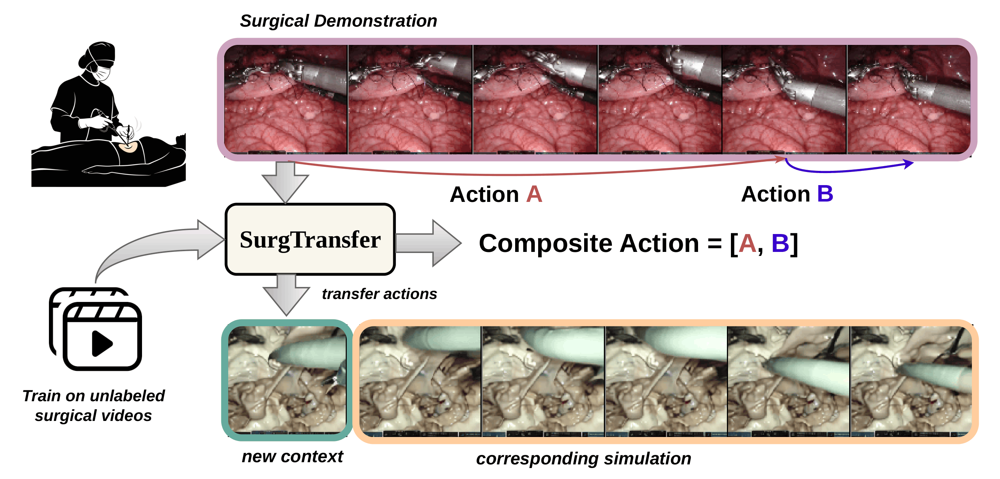
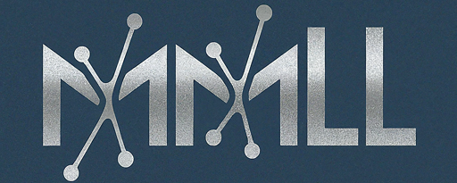
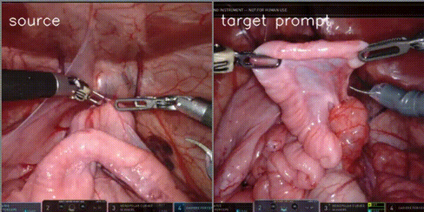
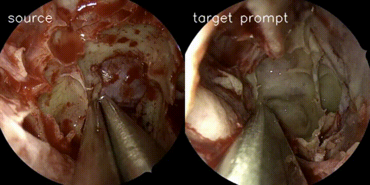

# [WACV 2027] SurgTransfer: Multi-Step Latent Action Modeling for Action Transfer in Surgical World Model

<div align="center">
  <i><a href="https://saurabhkoju.com.np">Saurabh Koju</a><sup>*</sup>, Love Panta<sup>*</sup>, Deepak Thapa, Rudra Poudel, Prajwal Ghimire, Angus Watson, Yash Raj Shrestha, Prashanna Gyawali, Binod Bhattarai</i>
</div>

<div align="center">
  <br>
  
  <br>
  <a href="https://naamii.org/research/research-groups/mmll-b-bhattarai-multi-modal-lab">Multi-Modal Learning Lab</a>
</div>

\
SurgTransfer <sup>[1]</sup> represents our latest work in surgical world models. It presents a novel multi-step action learning framework to learn latent actions that are transferable across various surgical contexts. This repository contains the code for the Latent Action Model (LAM) and the Dynamics model used in SurgTransfer in addition to the code for the discrete LAM used in SurgWM <sup>[2]</sup>.

## Demos



## Codebase
The codebase can be divided into two major parts: Dynamics model and Latent Action Model. \
The codebase for the dynamics model is based on the [Stable Video Diffusion codebase](https://github.com/stability-ai/generative-models), which we are hugely indebted to. The code for Latent Action Model can be found inside the `action/` folder. Parts of the LAM codebase were adapted from the [1xgpt codebase](https://github.com/1x-technologies/1xgpt). \
Huge thanks to these amazing open source projects!

## Installation and Usage
Tested with Python 3.10
## Install Dependencies
```
pip install torch==2.10.0 torchvision==0.25.0 --index-url https://download.pytorch.org/whl/cu128
pip install -r requirements.txt
pip install -U deepseed  # if you want to use deepspeed parallel strategy
```

## Download Dataset
Download the *SurgToolLoc* dataset
```
cd your_data_path
gsutil cp gs://isi-surgtoolloc-2022/surgtoolloc2022_dataset.zip .
unzip surgtoolloc2022_dataset.zip
mv _release/training_data/video_clips .
```

## Train LAM
The *train.txt* and *val.txt* files at `data/` should contain video paths separated by new lines. 
```
cd action
. scripts/train.sh
```
Change folder paths for checkpoints at `action/utils/runs.py` line 3: `output_root` and `scratch_root`. Only the latest and the checkpoint with best val loss is saved to the first path while all checkpoints are saved to the latter path. Configure your wandb login before running the training script. \
Note the `first_frame_only` argument must be True for the multistep model. 

We provide a trained checkpoint for the latent action model [here](https://huggingface.co/mithochiya/SurgTransfer/tree/main). 

## Train Dynamics Model
- Download the base Stable Video Diffusion Img2Vid model ([svd.safetensors]( https://huggingface.co/stabilityai/stable-video-diffusion-img2vid/tree/main)) to the `checkpoints/` folder. 
- Change the LAM checkpoint path in `configs/surg_transfer.yaml`, line 87, to your trained LAM checkpoint. Make sure your arguments to the lightning trainer matches your available GPU configuration. 
- Finally, train the dynamics model from root with `source scripts/train.sh`. 

Visualizations will be periodically saved to WandB. You can control the visualization logging frequency, checkpointing frequency, and more from the config file.

We provide a trained checkpoint for the dynamics model [here](https://huggingface.co/mithochiya/SurgTransfer/tree/main). 

## Sampling
To reproduce the results of the paper, you can run `scripts/sample.sh` with the default arguments. Refer to `sample.py` for more supported arguments.

## Evaluation
Pass the argument `--compute_metrics` in `sample.py` to calcuate metrics after sampling. You will need to install the following additional dependency.
#### CDFVD 
- Install the library using the command: `pip install cd-fvd`. Please refer to the [official-repo](https://huggingface.co/mithochiya/SurgTransfer/tree/main) if you encounter any problems.
- Download the model checkpoints [vit_g_hybrid_pt_1200e_ssv2_ft.pth](https://huggingface.co/OpenGVLab/VideoMAE2/blob/c0aa78ff1c576fbfc18982a96a4ce9905ee8587d/mae-g/vit_g_hybrid_pt_1200e_ssv2_ft.pth) trained on SSv2 dataset.

Frame-level metrics are adapted from the pytorch-image-quality [library](https://github.com/photosynthesis-team/piq).


## References
[1] SurgTransfer: Multi-Step Latent Action Modeling for Action Transfer in Surgical World Model, Accepted at WACV 2027 \
[2] [Surgical Vision World Model](https://arxiv.org/abs/2503.02904v1), Presented at DEMI Workshop, MICCAI 2025

```bibtex
@inproceedings{koju2025surgical,
  title={Surgical vision world model},
  author={Koju, Saurabh and Bastola, Saurav and Shrestha, Prashant and Amgain, Sanskar and Shrestha, Yash Raj and Poudel, Rudra PK and Bhattarai, Binod},
  booktitle={MICCAI Workshop on Data Engineering in Medical Imaging},
  pages={1--10},
  year={2025},
  organization={Springer}
}
```

